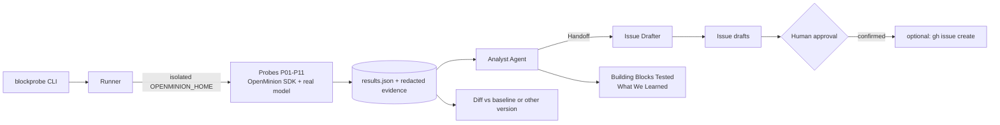

# BlockProbe — Product Requirements Document

> A canary for OpenMinion upgrades. Probe every building block with a real model, get a comparable report, and get bug reports that are ready to file.

| | |
|---|---|
| **Project** | BlockProbe |
| **Event** | Cortensor Hackathon #5 — build with the OpenMinion 0.1 Python SDK |
| **Target SDK** | `openminion` 0.1.x (0.1.4 was the latest PyPI release at the time of writing; docs on `main` already describe 0.1.5 changes) |
| **Build window** | 16 Oct – 18 Dec 2026 (Pacific Time). Hard deadline: Sat 19 Dec 2026, 14:59 WIB |
| **Document** | Draft v0.1 — 19 Oct 2026 |

---

## 1. Summary

BlockProbe is a command-line tool with a model-backed agent inside. It exercises OpenMinion's building blocks — agent runs, tools, sessions, streaming, permissions, memory, delegation, structured output, errors, diagnostics — against a real model and records what happened. An OpenMinion `Agent` then turns the raw results into three things: a **Building Blocks Tested** table, a **What We Learned** note, and **bug-report drafts** in the hackathon's template. Running the same suite on two OpenMinion versions (or two models) produces a diff.

The single repeatable workflow: **upgrade → probe → analyze → review → report**.

## 2. Problem

- OpenMinion is a fast-moving alpha. PyPI shows five releases between 5 and 12 Oct 2026 (0.1.0 → 0.1.4), and the project says long-running autonomy and provider-specific quality are still proof-gated. Builders cannot tell what an upgrade, or a different model, changed for their agents without re-testing by hand.
- The hackathon asks every builder for the same write-ups (what worked, what broke, what should improve) plus reproducible bug reports. Done by hand this is slow, inconsistent and hard to reproduce.
- Maintainers act faster on reports that carry version, environment, steps, expected/actual behaviour and redacted evidence. A harness can capture all of that automatically.

## 3. Goals and non-goals

**Goals**

1. One command runs a docs-anchored probe suite against a real model and writes machine-readable and human-readable results.
2. Every non-pass is classified (product failure, flaky, or harness error) and linked to evidence.
3. The same suite on two versions or two providers produces a diff: regressions, fixes, pass-rate and latency changes.
4. An OpenMinion agent drafts the two required hackathon notes and the bug drafts, with every claim tied to evidence.
5. A stranger can reproduce a run on a clean machine in 10 minutes or less with only a provider credential.

**Non-goals**

- A web frontend, hosted service, multi-user setup, or production deployment.
- Replacing OpenMinion's own tests, or certifying long-duration autonomy.
- Security research. Probes call documented APIs only. Anything security-sensitive is reported privately (hackathon team / OpenMinion security policy), never drafted as a public issue.
- Auto-filing issues. Publishing is always a manual, confirmed step.

## 4. Users

| User | Need |
|---|---|
| Agent builders on OpenMinion | Know in minutes whether an upgrade or a model switch breaks their agents |
| Hackathon builders and the Cortensor / OpenMinion team | Comparable, reproducible building-block findings |
| OpenMinion maintainers | Triage-ready bug drafts with steps, expected/actual behaviour and safe evidence |

## 5. Why this project

The hackathon lists a "release assistant" and a "QA helper" among its example projects, weights building-block findings at 25%, and rewards one repeatable workflow over feature count. BlockProbe produces those findings as a by-product of normal operation.

| Alternative | Why not |
|---|---|
| Research-brief agent | Crowded idea, touches few building blocks |
| Docs assistant | Needs a corpus and an evaluation set |
| Issue-triage agent | Needs real issue data and labels |
| **BlockProbe** | Needs only the SDK and one provider, touches about ten building blocks, and its output is the required notes |

## 6. Core workflow

```text
blockprobe doctor                                  # environment ok? provider reachable? budget set?
blockprobe run --profile quick --analyze           # probes -> results.json -> analyst -> notes + drafts
blockprobe matrix --versions 0.1.3,0.1.4           # same suite per OpenMinion version, then diff
blockprobe diff runs/<a> runs/<b>                  # regressions / fixes / latency / pass-rate
blockprobe publish runs/<id>/issues/ISSUE-01.md    # optional, manual, asks for confirmation
```

1. **Probe** — the runner executes each probe in an isolated OpenMinion home, with repeats, timeouts and a model-call budget.
2. **Record** — results and redacted evidence go to `runs/<id>/`.
3. **Analyze** — the analyst agent reads results through tools and writes findings; an issue drafter prepares bug drafts.
4. **Review** — a human reads the drafts; nothing leaves the machine without confirmation.
5. **Report / diff** — reports can be re-rendered from `results.json`; diffs compare any two runs.

## 7. Functional requirements

| ID | Requirement | Priority |
|---|---|---|
| FR-01 | **Environment capture:** OS, Python, `openminion.__version__`, install source, provider and model names (no secrets), `openminion doctor --check-turn --json` output, timestamp. | Must |
| FR-02 | **Isolated runs:** each run gets its own `OPENMINION_HOME` / `OPENMINION_DATA_ROOT` under `runs/<id>/` so probes never touch real sessions or memory. | Must |
| FR-03 | **Probe runner:** per-probe timeout, repeats, global model-call budget. One probe failing never aborts the run. Status per probe: PASS, FLAKY, FAIL, SKIP, ERROR, with pass-rate and latency (p50/p95). | Must |
| FR-04 | **Docs-anchored probes:** each probe declares the doc reference it verifies (`doc_ref`) and the OpenMinion versions it applies to. | Must |
| FR-05 | **MVP probe set:** P01, P02, P03, P04, P06, P10. | Must |
| FR-06 | **Redaction:** strip API keys, tokens, emails and user home paths from all evidence before storage or model input. | Must |
| FR-07 | **Report renderer:** `results.json` and `building-blocks-tested.md`. | Must |
| FR-08 | **Analyst agent** (OpenMinion `Agent`): reads results and evidence through tools, writes `what-we-learned.md` as structured findings. Every finding carries evidence references validated outside the model. It never changes a probe's status. | Must |
| FR-09 | **Diff:** compare two runs (versions or providers): regressions, fixes, pass-rate and latency changes. | Must |
| FR-10 | **Full probe set:** P05, P07, P08, P09, P11. | Should |
| FR-11 | **Version matrix:** per-version virtual environments (`python -m venv` + `pip install openminion==X`), probes run in a subprocess. | Should |
| FR-12 | **Issue drafter:** one draft per FAIL/FLAKY probe using the hackathon bug template. Suspected security issues go to a private note instead. | Should |
| FR-13 | **Approval gate:** `publish` is off by default and needs typed confirmation. The analyst's file writes are limited to `runs/<id>/` through `approval_callback`. | Should |
| FR-14 | **Provider profiles:** swap provider/model per run (default provider; Portal / Gemma4 when access exists) and compare reliability and latency. | Should |
| FR-15 | **Delegation mode** (`--delegate`): the analyst hands drafting to the issue drafter via `Handoff`, with fallback to single-agent drafting. | Could |
| FR-16 | **Memory mode** (`--memory`): the analyst recalls earlier runs through OpenMinion memory in addition to JSON baselines. | Could |
| FR-17 | **HTML report** (panel layout) and a GitHub Action that runs a nightly canary. | Could |

**MVP acceptance criteria**

- On a clean machine with a provider credential, `blockprobe run --profile quick` finishes in 10 minutes or less and writes `runs/<id>/results.json` and `building-blocks-tested.md`.
- The report lists at least 6 probes with status, repeat count and p50 latency.
- A second run produces the same report structure (values may vary with the model).
- Harness tests pass on the echo provider without any credential.

## 8. Probe catalog

A probe asserts a behaviour that OpenMinion's own docs promise, so a failure is a bug or a docs gap, never an opinion. Where possible, assertions avoid depending on model wit (callbacks fired, exceptions raised, ids preserved).

| ID | Building block | Asserts (documented behaviour) | Model? |
|---|---|---|---|
| P01 | Public contract | Documented root exports and `openminion.api` exports import; documented console scripts exist; `__version__` is readable. Compared with `contracts/0.1.x.json` built from `API_COMPATIBILITY.md`. | No |
| P02 | Agent execution | `Agent.run()` returns an `AgentRunResult` with text, `session_id`, result ID and stats. `with Agent(...)` cleans up. | Yes |
| P03 | Tools | A `@tool` function is called with typed arguments. `tools=[]` disables application tools even when a tool call is forced. Functional `tool(fn, **options)` behaves like the decorator. | Yes |
| P04 | Sessions | The same `session_id` keeps context across runs and instances, a different id does not, and `AgentRunResult.session_id` equals the id passed in. | Yes |
| P05 | Streaming and cancel | `run_stream()` delivers ordered progress. `APIRuntime.submit_turn()` returns a `RuntimeTurnHandle` that yields `TurnChunk`s and resolves a `TurnResponse`. After cancel, no further provider or tool work starts and no late answer is appended. | Yes |
| P06 | Errors and timeouts | A bad credential or unreachable provider raises `ProviderError` (`code`, `message`, `details`) instead of returning an error string as an answer. A short `timeout_seconds` raises `TurnTimeoutError` (documented from 0.1.5), distinct from `ProviderError`. Provider failure is reported before output validation. | No |
| P07 | Memory | A record stored in one process is recalled in the next, scope is respected, and `memctl list/search` agrees with `POST /memory/records/search`. | Yes |
| P08 | Permissions and approvals | A policy-gated tool reaches `approval_callback` before execution. True allows once, false or a callback error blocks. `resolve_approval` accepts only `allow_once` and `deny`, and a stale id returns False. File tools stay inside the workspace, and host commands stay disabled without a sandbox. | Yes |
| P09 | Delegation | `Handoff` / `subagent` / `handoffs=` transfer work and return the child result to the parent. Exposing a handoff does not waive policy confirmation. | Yes |
| P10 | Diagnostics | `openminion doctor --check-turn --json` parses and passes. `openminion status readiness` reports ready (not demo) with a real provider. `agent inspect --json` and `agent logs` are readable. | Partly |
| P11 | Structured output | Pydantic output returns a valid object, invalid output raises `AgentOutputValidationError`, and prose-wrapped JSON is accepted during 0.1.x (recorded, not judged). | Yes |

**Stretch probes:** P12 local HTTP API and daemon (`GET /sessions/{id}/events` cursor, `POST /v1/approvals/resume`, token required off loopback, tested on localhost only) · P13 skills (`skillctl`, example skill) · P14 rooms (`openminion room`) · P15 provider comparison (P02–P05 on a second provider, for example Portal / Gemma4).

**Probe statuses:** PASS · FLAKY (pass-rate between 0 and 1) · FAIL (0 of N, product behaviour) · SKIP (feature absent in this version) · ERROR (harness problem, never drafted as a bug).

## 9. Agents

**Analyst** (always on with `--analyze`)

- Built as `Agent(instructions=..., tools=[read_result, read_evidence, compare_baseline, write_section], config_path=..., agent_id="analyst", session_id=f"analyst-{run_id}")`.
- Output is a Pydantic `Findings` model (title, probe id, severity, summary, evidence refs, suggested improvement). `AgentOutputValidationError` triggers one retry.
- Evidence rule: every statement carries refs like `[P03#2]`. A deterministic validator rejects findings whose refs do not exist.
- Permissions: read-only except `write_section`, which `approval_callback` allows only for paths inside `runs/<id>/`. No shell or network tools.
- It explains results. It never changes a probe's status.

**Issue drafter** (`--delegate`, optional)

- Receives FAIL/FLAKY probes and drafts one issue each in the template of section 12. Flags suspected security issues for a private note.
- The analyst reaches it through `Handoff`. If delegation fails, the analyst drafts inline.

## 10. Architecture and SDK usage



| Building block | SDK surface | Used in |
|---|---|---|
| Agent execution | `Agent`, `Agent.run`, `AgentRunResult` | P02, analyst |
| Tools | `@tool`, `tool(fn, **options)`, `tools=` allowlist | P03, analyst tools |
| Sessions | `session_id`, `AgentRunResult.session_id` | P04, analyst session |
| Streaming and cancel | `Agent.run_stream`, `APIRuntime.submit_turn`, `RuntimeTurnHandle`, `TurnChunk`, `cancel_event` | P05 |
| Models and providers | `ProviderError`, `config_path`, `agent_id`, `OpenMinionConfig` | P02, P06, provider profiles |
| Timeouts | `timeout_seconds`, `TurnTimeoutError` | P05, P06 |
| Permissions | `approval_callback`, `resolve_approval`, permission modes | P08, analyst write policy, publish gate |
| Memory | `MemoryBundle`, `memctl`, `/memory/records/*` | P07 |
| Delegation | `Handoff`, `subagent`, `handoffs=` | P09, analyst to issue drafter |
| Structured output | Pydantic output, `AgentOutputValidationError` | P11, analyst findings |
| Diagnostics | `doctor --check-turn --json`, `status readiness`, `agent inspect`, `agent logs`, `TurnTelemetry` | P10, environment capture |

Names come from `API_COMPATIBILITY.md` and `docs/runtime-surfaces.md` (mid-Oct 2026). Exact signatures are confirmed against the installed version in Phase 0.

## 11. Project structure

```text
blockprobe/
├── README.md
├── PRD.md
├── ROADMAP.md
├── FINDINGS.md                  # running dogfood log, source of the two required notes
├── pyproject.toml
├── uv.lock                      # or requirements.lock
├── Makefile                     # setup | quick | full | matrix | test | demo
├── .env.example                 # variable names only, no secrets
├── config/
│   ├── agents.example.json      # project-owned OpenMinion config (analyst, issue-drafter)
│   └── profiles/                # provider/model profiles (default, portal)
├── contracts/
│   └── 0.1.x.json               # documented exports and CLI names per API_COMPATIBILITY.md
├── src/blockprobe/
│   ├── cli.py                   # doctor | run | analyze | matrix | diff | report | publish
│   ├── runner.py                # repeats, timeouts, budget, per-probe isolation
│   ├── env.py                   # version/OS/provider capture, isolated OPENMINION_* dirs
│   ├── models.py                # ProbeResult, RunSummary, Finding
│   ├── redact.py                # strip keys, tokens, user paths from evidence
│   ├── gate.py                  # approval gate: publish + approval_callback policy
│   ├── probes/
│   │   ├── base.py              # Probe interface: id, doc_ref, versions, model?, run()
│   │   └── p01_contract.py ... p11_structured_output.py
│   ├── agents/
│   │   ├── analyst.py           # Agent + findings output
│   │   ├── issue_drafter.py     # handoff target
│   │   └── tools.py             # read_result, read_evidence, compare_baseline, write_section
│   └── report/
│       ├── render.py            # Building Blocks Tested + diff tables
│       └── templates/           # *.md string templates
├── tests/                       # harness tests on the echo provider, no credentials
├── examples/sample-run/         # committed real run: results.json, report, issue drafts
├── baselines/                   # per-version baseline results
├── runs/                        # gitignored: per-run output and isolated OpenMinion data
└── docs/
    └── demo-script.md           # from Appendix A
```

## 12. Report and issue formats

**Building Blocks Tested** (illustrative values, not real results)

| Building block | Probe | Result | Pass rate | p50 latency | Evidence / note |
|---|---|---|---|---|---|
| Agent execution | P02 | PASS | 3/3 | 1.8 s | |
| Tools | P03 | FLAKY | 2/3 | 3.4 s | wrong argument type once (E-P03-2) |
| Errors | P06 | FAIL | 0/3 | n/a | expected `ProviderError`, got a returned string (E-P06-1) |

**What We Learned** — one entry per finding: title, building block, severity, summary, evidence refs, suggested improvement. Ends with a short "what worked well" list so the note is balanced.

**Issue draft** (matches the hackathon's bug-report requirements)

```markdown
**Title:** [P0X] short description
**Affected version / environment:** openminion X.Y.Z, Python 3.x, OS, provider/model (no secrets)
**Steps to reproduce:** minimal script or commands
**Expected:** behaviour the docs promise
**Actual:** what happened
**Impact:** who is affected and how badly
**Evidence:** redacted log excerpt, request ID or screenshot
**Doc reference:** file and section that defines the expected behaviour
```

Drafts are checked against existing OpenMinion issues before anyone files them. For the bug-fix bonus: file the issue, wait for the team to acknowledge it and confirm a fix is in scope, then submit a substantive fix PR and link both in the submission.

## 13. Non-functional requirements

- **Reproducible:** pinned `openminion` range in `pyproject.toml`, lock file, `make setup`, a committed sample run, and the exact OpenMinion version recorded in every report.
- **Cost-aware:** the `quick` profile makes roughly 20–40 provider calls; `--budget` is a hard cap. The echo provider is used for harness tests only, since it never calls a model (model-dependent probes are SKIPped there).
- **Safe by default:** redaction before storage and before model input, a read-only analyst, no auto-publish, no secrets in the repo.
- **Portable:** Windows (PowerShell) and Linux are first-class, macOS best effort. Platform-specific rough edges are findings.
- **Observable:** every run keeps logs, and OpenMinion's own `agent logs` / `agent inspect` output is attached as evidence.
- **Demo-friendly:** the `quick` profile finishes in 10 minutes or less (5 as a target).

## 14. Hackathon mapping

| Criterion (weight) | How BlockProbe addresses it |
|---|---|
| Working functionality and useful outcome (25%) | One command: probes, report and bug drafts; useful on every OpenMinion upgrade |
| Meaningful OpenMinion SDK usage (20%) | Agents and probes run on `Agent`, `@tool`, sessions, streaming/`submit_turn`, approvals, `Handoff`, structured output and `ProviderError` (section 10) |
| Reproducibility and demo quality (20%) | Pinned deps, `quick` profile, committed sample run, clean-machine test, scripted demo |
| Building-block findings and feedback (25%) | The report is the findings; `FINDINGS.md` is a dogfood log kept from day 1 |
| Relevance to Cortensor builder workflows (10%) | QA / release-assistant workflow; provider-agnostic and works with Portal when access exists |

| Hackathon requirement | Deliverable |
|---|---|
| Public repo and README with setup and run steps | `README.md`, `Makefile`, `.env.example` |
| Short explanation of the OpenMinion SDK workflow | README section "How BlockProbe uses the SDK" (the table in section 10) |
| One working example and a 1–5 minute demo | `examples/sample-run/`, `docs/demo-script.md`, video |
| Building Blocks Tested note | Generated `building-blocks-tested.md`, hand-edited |
| What We Learned note | Generated `what-we-learned.md` plus `FINDINGS.md`, hand-edited |
| Bug reports and bonus fix PR | `issues/` drafts, GitHub issues, fix PR only after team acknowledgement |

## 15. Success metrics

- Clean-machine setup to first report in 10 minutes or less.
- At least 10 probes covering at least 8 building blocks, run on a real model.
- At least 2 OpenMinion versions compared, and a reliability table for at least 1 provider (2 if Portal / Gemma4 access exists).
- At least 5 documented findings, at least 1 with a full reproduction in the bug template.
- Demo video of 4:30 or less, and the PR submitted at least 3 days before the deadline.
- Bonus: at least 1 team-acknowledged bug with a substantive fix PR.

## 16. Risks and mitigations

| Risk | Likelihood | Mitigation |
|---|---|---|
| API drift: OpenMinion ships almost weekly | High | Pin the version, record it in every report, keep contract snapshots in `contracts/`, re-run weekly |
| Model nondeterminism causes false failures | High | Prefer assertions that do not depend on model wit, use repeats with pass-rate, and the FLAKY class |
| False bug reports | Medium | ERROR class for harness problems, `doc_ref` on every probe, human review before anything is filed |
| Provider cost or quota | Medium | `quick` profile, `--budget` cap, echo-provider harness tests |
| No Portal / Gemma4 access | Medium | Optional by design, provider profiles are pluggable |
| Isolated home cannot see provider credentials | Medium | Verify in Phase 0, fall back to passing credentials through the environment |
| Scope creep | High | MVP first, follow the scope-cut order in `ROADMAP.md` |
| Seen as "a test tool, not a product" | Medium | Position as an upgrade canary and lead the demo with a real before/after diff |

## 17. Open questions (verify in Phase 0)

1. How do provider credentials reach an isolated `OPENMINION_HOME` (environment variable or copied config)? Check `openminion setup` and the docs.
2. Exact SDK shapes for memory reads/writes (`MemoryBundle`), `Handoff` / `subagent` construction, and how to force a tool call. Read `examples/sdk/` after cloning the repo to confirm signatures.
3. Is 0.1.5 released yet, and which version does the hackathon repo expect? Pin accordingly.
4. Hackathon #5 repository URL and PR format, and whether DoraHacks "Submit Build" is also required.
5. Which provider and model, with what spend cap, and is Portal / Gemma4 access available?
6. Does the OpenMinion repo have an issue template? If so, mirror it in the drafts.

## Appendix A — Demo script (1–5 minutes)

| Time | Beat |
|---|---|
| 0:00–0:30 | The problem: OpenMinion ships weekly, and an upgrade can silently change agent behaviour |
| 0:30–1:30 | `blockprobe run --profile quick` on a real model; show probes running and the live status |
| 1:30–2:15 | The Building Blocks Tested table: PASS, FLAKY, FAIL with pass-rates and latency |
| 2:15–3:00 | The analyst's What We Learned note, with evidence refs opened on screen |
| 3:00–3:45 | `blockprobe diff` between two OpenMinion versions: what regressed, what got fixed |
| 3:45–4:30 | An issue draft in the bug template, and the approval gate refusing to publish without confirmation |
| 4:30–5:00 | Wrap-up: where to find the repo, the sample run, and how to reproduce in 10 minutes |
