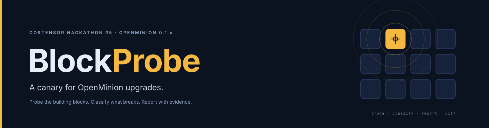
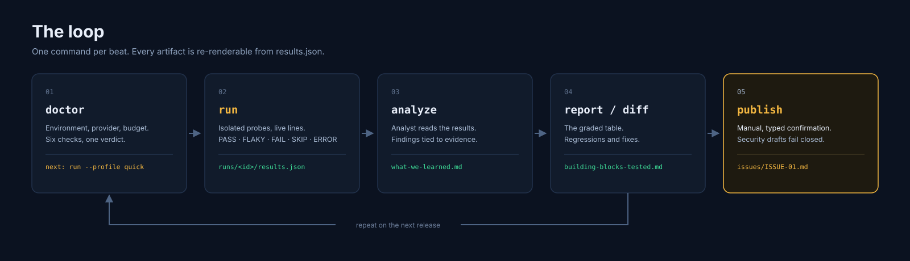
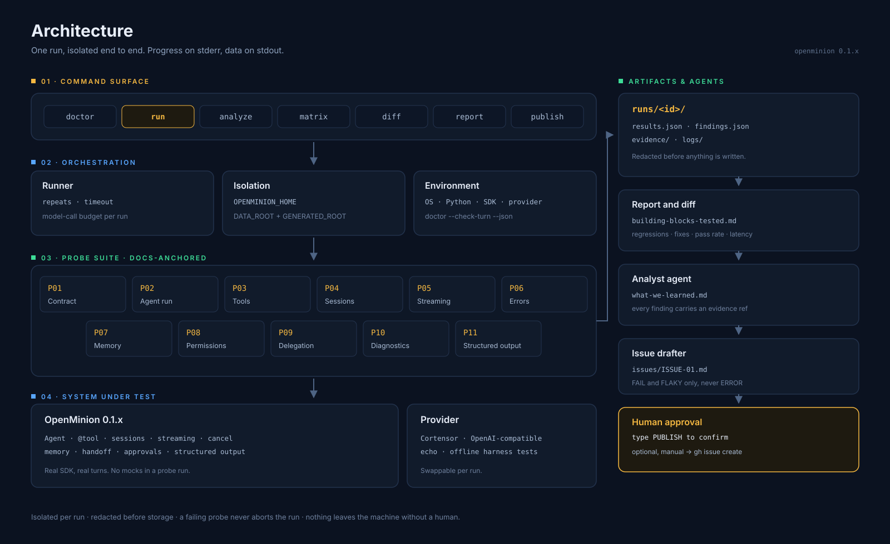

<p align="center">
  
</p>

<p align="center">
  <a href="https://www.python.org/downloads/"></a>
  <a href="#status"></a>
  <a href="LICENSE"></a>
</p>

**BlockProbe is a command-line canary for OpenMinion upgrades.** It runs a
docs-anchored probe suite against a real model, records what the SDK actually
did, classifies every non-pass, and turns the results into a report you can
compare across versions and bug-report drafts that are ready to file.

```text
doctor  →  run  →  analyze  →  report / diff  →  publish (optional, manual)
```

Built for **Cortensor Hackathon #5** — build with the OpenMinion 0.1 Python SDK.

---

## Table of contents

- [Status](#status)
- [Why BlockProbe](#why-blockprobe)
- [How it works](#how-it-works)
- [Architecture](#architecture)
- [The probe suite](#the-probe-suite)
- [Statuses, exit codes and the gate](#statuses-exit-codes-and-the-gate)
- [Reports and issue drafts](#reports-and-issue-drafts)
- [CLI reference](#cli-reference)
- [Quickstart](#quickstart)
- [How BlockProbe uses the OpenMinion SDK](#how-blockprobe-uses-the-openminion-sdk)
- [Project structure](#project-structure)
- [Design principles](#design-principles)
- [Roadmap](#roadmap)
- [Development](#development)
- [Contributing](#contributing)
- [License](#license)

## Status

BlockProbe is in active development. The table records what exists today, not
what is planned.

| Area | State |
|---|---|
| Packaging, Makefile and pytest harness | Done |
| Result models (`ProbeStatus`, `ProbeResult`, `RunSummary`, `Finding`) | Done |
| Redaction of keys, tokens, emails and home paths | Done |
| Terminal primitives and the run renderer (internal, not yet wired) | Done |
| Markdown report | Done |
| `doctor` and the CLI entry point | Done |
| Probe runner, isolation and call budget | Next |
| Probes P01–P11 | Next |
| Analyst agent, diff, matrix and publish gate | Later |

`blockprobe doctor` and `blockprobe report` are wired today; the other
commands are specified in the [CLI reference](#cli-reference) and land in the
order shown in the [roadmap](#roadmap). The probe runner is the next milestone.

## Why BlockProbe

OpenMinion is a fast-moving alpha: five releases landed between 5 and 12 October
2026, and the project still describes long-running autonomy and
provider-specific quality as proof-gated. A version bump can silently change how
a tool call, a session, a stream or a provider error behaves.

A builder then has two bad options: re-test by hand, or find out in production.
Hand-testing is slow, inconsistent, and produces reports nobody can compare.
BlockProbe makes the check repeatable:

- one command runs a documented probe suite against a real model;
- every non-pass is classified instead of guessed at;
- every claim points at evidence, and every artifact is regenerable;
- two runs — two versions or two providers — produce a diff, not a vibe.

The output is also the hackathon deliverable: a **Building Blocks Tested**
table, a **What We Learned** note, and **issue drafts** in the bug-report
template.

## How it works

<p align="center">
  
</p>

| Beat | Command | What happens | Artifact |
|---|---|---|---|
| **1 · Doctor** | `blockprobe doctor` | Captures OS, Python and OpenMinion versions, the provider and model, and whether a turn can actually be executed. | Environment capture |
| **2 · Run** | `blockprobe run --profile quick` | Executes each probe in an isolated OpenMinion home with repeats, timeouts and a model-call budget. One probe failing never aborts the run. | `runs/<id>/results.json` |
| **3 · Analyze** | `blockprobe run --analyze` or `blockprobe analyze` | An OpenMinion agent reads the results and writes structured findings, each tied to an evidence reference. It never changes a probe's status. | `runs/<id>/what-we-learned.md` |
| **4 · Report / diff** | `blockprobe report`, `blockprobe diff` | Renders the graded table and compares two runs: regressions, fixes, pass rate and latency. | `building-blocks-tested.md` |
| **5 · Publish** | `blockprobe publish` | Shows the full draft, then requires the literal word `PUBLISH`. Security-sensitive drafts fail closed. | `issues/ISSUE-01.md`, optional `gh issue create` |

`doctor` writes no artifact of its own; it is the gate that stops a run from
failing later for an obvious reason (wrong provider, missing credential,
exhausted budget).

## Architecture

<p align="center">
  
</p>

| Layer | Components | Responsibility |
|---|---|---|
| **Command surface** | `cli.py` | One command per beat: `doctor`, `run`, `analyze`, `matrix`, `diff`, `report`, `publish`. Progress on stderr, data on stdout. |
| **Orchestration** | `runner.py`, `env.py`, `gate.py` | Repeats, per-probe timeout, global model-call budget, per-run isolation, environment capture, approval policy. |
| **Probe suite** | `probes/base.py`, `p01_contract.py` … `p11_structured_output.py` | Eleven docs-anchored probes. Each declares its `doc_ref`, applicable versions and whether it needs a model. |
| **System under test** | `openminion` 0.1.x, provider | Real SDK and real turns. The provider is swappable per run; the echo provider is used for offline harness tests. |
| **Artifacts** | `runs/<id>/` | `results.json`, `findings.json`, redacted `evidence/`, `logs/`. Everything a report needs is here. |
| **Agents** | `agents/analyst.py`, `agents/issue_drafter.py`, `agents/tools.py` | The analyst explains; the drafter writes bug drafts. Neither can change a probe's status. |
| **Human gate** | `gate.py` | Nothing is published without a typed `PUBLISH`. No non-interactive path exists. |

Three boundaries carry most of the design weight:

1. **Isolation** — every run gets its own `OPENMINION_HOME`, `OPENMINION_DATA_ROOT`
   and `OPENMINION_GENERATED_ROOT`, so probes never touch real sessions or memory.
2. **Redaction** — evidence is stripped of keys, tokens, emails and home paths
   before it is written to disk or sent to a model.
3. **Classification** — a harness problem is an `ERROR`, not a product failure, so
   a broken test never becomes a false bug report.

## The probe suite

Each probe asserts something OpenMinion's documentation promises. A failure is a
bug or a documentation gap, never a matter of taste. Where possible, assertions
avoid model wit: callbacks fired, exceptions raised, ids preserved.

| Probe | Building block | Asserts | Model |
|---|---|---|---|
| **P01** | Public contract | Documented root and `openminion.api` exports import; documented console scripts exist; `__version__` is readable. | No |
| **P02** | Agent execution | `Agent.run()` returns an `AgentRunResult` with text, `session_id`, result id and stats. `with Agent(...)` cleans up. | Yes |
| **P03** | Tools | A `@tool` function receives typed arguments. `tools=[]` disables application tools even when a call is forced. `tool(fn, **options)` matches the decorator. | Yes |
| **P04** | Sessions | The same `session_id` keeps context across runs and instances; a different id does not; `AgentRunResult.session_id` equals the id passed in. | Yes |
| **P05** | Streaming and cancel | `run_stream()` delivers ordered progress. `APIRuntime.submit_turn()` yields `TurnChunk`s and resolves a `TurnResponse`. After cancel, no further provider or tool work starts. | Yes |
| **P06** | Errors and timeouts | A bad credential or unreachable provider raises `ProviderError` instead of returning an error string as an answer. A short `timeout_seconds` raises `TurnTimeoutError`. | No |
| **P07** | Memory | A record stored in one process is recalled in the next; scope is respected; `memctl` agrees with `POST /memory/records/search`. | Yes |
| **P08** | Permissions and approvals | A gated tool reaches `approval_callback` before execution. Deny blocks. `resolve_approval` accepts only `allow_once` and `deny`. File tools stay inside the workspace. | Yes |
| **P09** | Delegation | `Handoff` / `subagent` / `handoffs=` transfer work and return the child result to the parent. Exposing a handoff does not waive policy confirmation. | Yes |
| **P10** | Diagnostics | `doctor --check-turn --json` parses and passes. `status readiness` reports ready (not demo). `agent inspect --json` and `agent logs` are readable. | Partly |
| **P11** | Structured output | Pydantic output returns a valid object; invalid output raises `AgentOutputValidationError`; prose-wrapped JSON is recorded, not judged. | Yes |

**Profiles.** `quick` runs the six MVP probes — P01, P02, P03, P04, P06, P10 —
in about 20–40 model calls and under ten minutes. `full` runs all eleven.
Stretch probes (P12–P15: local HTTP API, skills, rooms, a second provider) are
backlog, not commitments.

## Statuses, exit codes and the gate

Five statuses, and only two of them can ever become a bug draft.

| Status | Meaning | Bug draft? |
|---|---|---|
| `PASS` | The documented behaviour held on every repeat. | No |
| `FLAKY` | Pass rate between zero and one. Printed loudly, but not a regression. | Yes |
| `FAIL` | Zero of N repeats passed — a product failure. | Yes |
| `SKIP` | The feature does not exist in this OpenMinion version. | No |
| `ERROR` | The harness itself broke. Never blamed on the product. | Never |

Exit codes follow the same logic:

| Code | Meaning |
|---|---|
| `0` | Success — every probe is `PASS`, `SKIP` or `FLAKY` |
| `1` | Product failure — at least one probe is `FAIL` or `ERROR` |
| `2` | Usage error, or a cancelled publish |
| `3` | Budget exhausted |
| `4` | Provider or environment unavailable |

`FLAKY` exits `0` on purpose. Model nondeterminism is the most likely source of
false failures; if flakiness turned the canary red, the canary would be ignored.
The gate is `FAIL` and `ERROR`.

Publishing is manual twice over: security-sensitive drafts fail closed when
their front matter is missing or unparseable, and a public draft requires the
exact, case-sensitive word `PUBLISH`. Without a TTY the command refuses rather
than accepting piped input.

## Reports and issue drafts

**Building Blocks Tested** — six columns in the Markdown file, five in the
terminal. Illustrative values:

| Building block | Probe | Result | Pass rate | p50 latency | Evidence / note |
|---|---|---|---|---|---|
| Agent execution | P02 | `PASS` | 3/3 | 1.8 s | |
| Tools | P03 | `FLAKY` | 2/3 | 3.4 s | wrong argument type once (E-P03-2) |
| Errors | P06 | `FAIL` | 0/3 | n/a | expected `ProviderError`, got answer text (E-P06-1) |

**What We Learned** — a flat, numbered list. Every finding carries its building
block, severity, an evidence reference that is validated outside the model, and
a suggested improvement:

```text
1  Tool argument types are not enforced
   Tools · severity medium · E-P03-2
   A @tool function received an int for a str field in 1 of 3 runs.
   → coerce or raise before invoking the tool function
```

**Issue draft** — one file per `FAIL` or `FLAKY` probe, in the hackathon's bug
template:

```markdown
**Title:** [P0X] short description
**Affected version / environment:** openminion X.Y.Z, Python 3.x, OS, provider/model
**Steps to reproduce:** minimal script or commands
**Expected:** behaviour the docs promise
**Actual:** what happened
**Impact:** who is affected and how badly
**Evidence:** redacted log excerpt, request ID or screenshot
**Doc reference:** file and section that defines the expected behaviour
```

Drafts are checked against existing OpenMinion issues before anything is filed.
Generated notes are human-owned: `blockprobe report` never overwrites a file
that already exists unless `--force` is passed.

## CLI reference

The interface is fixed by the PRD and the CLI UX design. Commands land in the
order shown in the roadmap.

| Command | What it does | Status |
|---|---|---|
| `blockprobe doctor` | Checks environment, provider and budget; one verdict line. | Available |
| `blockprobe run` | Runs the probe suite and writes `runs/<id>/`. | Planned · Phase 1 |
| `blockprobe report` | Re-renders a saved run; prints the raw deliverable with `--md`. | Available |
| `blockprobe analyze` | Runs the analyst over an existing run. | Planned · Phase 2 |
| `blockprobe diff` | Compares two runs: regressions, fixes, unstable, added, removed. | Planned · Phase 2 |
| `blockprobe matrix` | Runs the same suite across several OpenMinion versions. | Planned · Phase 2 |
| `blockprobe publish` | Publishes one issue draft after a typed confirmation. | Planned · Phase 3 |

| Flag | Applies to | Meaning |
|---|---|---|
| `--profile quick\|full` | `run`, `matrix` | Six MVP probes or all eleven. |
| `--budget N` | `run`, `matrix` | Hard cap on model calls. |
| `--provider NAME` | `doctor`, `run`, `matrix` | Provider profile from `config/profiles/`. |
| `--analyze` | `run` | Run the analyst immediately after the probes. |
| `--json` | data commands | Machine-readable payload on stdout, no progress lines. |
| `--no-color` | all | Drop ANSI colour; also honours `NO_COLOR` and non-TTY stdout. |
| `--force` | `report` | Overwrite an existing, hand-edited note. |
| `--md` | `report` | Print the raw Markdown, not the terminal table. |
| `--delegate` | `analyze` | Hand drafting to the issue drafter through `Handoff`. |
| `--memory` | `analyze` | Recall earlier runs through OpenMinion memory. |

`--profile` and `--provider` are different namespaces: the profile selects the
probe suite, the provider selects the model endpoint.

## Quickstart

Requires Python 3.11 or newer and Git.

```bash
git clone https://github.com/panzauto46-bot/BlockProbe.git
cd BlockProbe
python -m venv .venv
```

Activate the virtual environment:

```powershell
# Windows PowerShell
.venv\Scripts\Activate.ps1
```

```bash
# Linux and macOS
source .venv/bin/activate
```

Install the package and run the test suite:

```bash
python -m pip install -e ".[dev]"
python -m pytest -q
python -m blockprobe --version
```

The test suite needs no provider credential and no network access. It runs
entirely offline.

**What works today:** the package installs, the models, redaction module and
Markdown report are covered by tests, `python -m blockprobe --version` prints
the version, and `blockprobe doctor` / `blockprobe report` run against a saved
`results.json` — terminal, Markdown and JSON. Probe runs arrive with the runner.

## How BlockProbe uses the OpenMinion SDK

BlockProbe is not a wrapper around one API. It exercises the SDK's building
blocks, and the same surfaces are used by its own agent:

| Building block | SDK surface | Used in |
|---|---|---|
| Agent execution | `Agent`, `Agent.run`, `AgentRunResult` | P02, analyst |
| Tools | `@tool`, `tool(fn, **options)`, `tools=` allowlist | P03, analyst tools |
| Sessions | `session_id`, `AgentRunResult.session_id` | P04, analyst session |
| Streaming and cancel | `Agent.run_stream`, `APIRuntime.submit_turn`, `RuntimeTurnHandle`, `TurnChunk`, `cancel_event` | P05 |
| Models and providers | `ProviderError`, `config_path`, `agent_id`, `OpenMinionConfig` | P02, P06, provider profiles |
| Timeouts | `timeout_seconds`, `TurnTimeoutError` | P05, P06 |
| Permissions | `approval_callback`, `resolve_approval`, permission modes | P08, analyst write policy, publish gate |
| Memory | `MemoryBundle`, `memctl`, `/memory/records/*` | P07 |
| Delegation | `Handoff`, `subagent`, `handoffs=` | P09, analyst → issue drafter |
| Structured output | Pydantic output, `AgentOutputValidationError` | P11, analyst findings |
| Diagnostics | `doctor --check-turn --json`, `status readiness`, `agent inspect`, `agent logs`, `TurnTelemetry` | P10, environment capture |

The analyst is a real OpenMinion `Agent`, not a prompt in a script: it reads
results through tools, returns a validated Pydantic `Findings` model, and writes
only inside `runs/<id>/` through `approval_callback`.

## Project structure

```text
BlockProbe/
├── src/blockprobe/
│   ├── __init__.py              package version
│   ├── __main__.py              python -m blockprobe
│   ├── models.py                ProbeStatus, ProbeResult, RunSummary, Finding
│   ├── redact.py                evidence and environment redaction
│   ├── terminal.py              colour, width and glyph primitives
│   ├── doctor.py                environment checks
│   ├── cli.py                   command surface (doctor, report)
│   ├── runner.py                repeats, timeout, budget        (planned)
│   ├── env.py                   version and provider capture    (planned)
│   ├── gate.py                  approval and publish policy     (planned)
│   ├── probes/                  P01–P11                         (planned)
│   ├── agents/                  analyst, drafter, tools         (planned)
│   └── report/                  terminal + Markdown renderers
├── tests/                       pytest suite; no network, no credentials
├── docs/
│   ├── assets/                  banner, architecture, workflow
│   └── superpowers/             design specs and implementation plans
├── contracts/                   documented exports per version  (planned)
├── config/                      agent config and provider profiles (planned)
├── examples/sample-run/         committed real run              (planned)
├── Makefile                     setup | quick | full | matrix | test | demo
├── pyproject.toml               packaging, dependencies, pytest config
├── PRD.md                       requirements and probe catalog
├── ROADMAP.md                   phases, milestones and scope cuts
└── README.md
```

## Design principles

1. **Evidence over opinion.** A probe asserts only what the documentation
   promises, and names the document it verifies. A failure is a bug or a docs
   gap, never a preference.
2. **Harness errors are not product failures.** A broken harness reports
   `ERROR`, so a broken test never becomes a false bug report.
3. **Nothing leaves the machine by accident.** Redaction happens before storage
   and before model input; publishing is manual and requires typed
   confirmation.
4. **The terminal is the product.** No web UI, no dashboard. Progress goes to
   stderr, data to stdout, colour is never the only signal, and every command
   ends with the next useful command.
5. **Human-owned notes.** Generated Markdown is a starting point. The tool never
   overwrites an edited note unless it is told to.

## Roadmap

| Phase | Dates | Goal | Milestone |
|---|---|---|---|
| **0 · Kickoff** | 19–25 Oct 2026 | Registered, installed, first real-model run, repo skeleton | M0 |
| **1 · MVP harness** | 26 Oct – 8 Nov | `run --profile quick` with six probes and a report | M1 |
| **2 · Analyst and full probes** | 9–22 Nov | Eleven probes, analyst agent, version diff | M2 |
| **3 · Issues and gate** | 23 Nov – 6 Dec | Bug drafts, approval gate, provider comparison | M3 |
| **4 · Polish and demo** | 7–13 Dec | Final README, sample run, clean-machine test, video | M4 |
| **5 · Submit** | 14–19 Dec | PR to the hackathon repository, submission, buffer | M5 |

Phase 0 is in progress. The full plan, scope-cut order and definition of done
live in [`ROADMAP.md`](ROADMAP.md).

## Development

```bash
make setup     # pip install -e ".[dev,probe]"
make test      # python -m pytest tests -v
```

`make setup` installs the optional `probe` extra, which pins
`openminion>=0.1.4,<0.2`. The `dev` extra installs pytest only, which is enough
for the offline suite.

Harness tests use the echo provider, so they never spend a token:

```bash
openminion config init --provider echo
```

`make quick`, `make full`, `make matrix` and `make demo` call commands that do
not exist yet and will fail until the runner lands.

## Contributing

Issues and pull requests are welcome. Before opening a pull request:

```bash
python -m pytest -q
```

Keep credentials out of the repository. A run redacts its own evidence, but
never paste a live key into an issue. If you add a probe, declare its `doc_ref`
and the OpenMinion versions it applies to.

## License

Released under the [MIT License](LICENSE).
